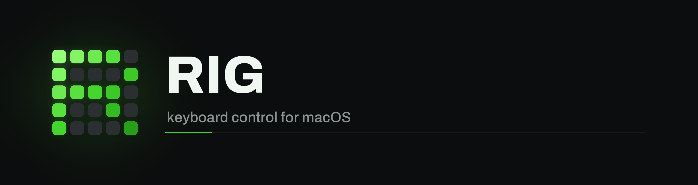
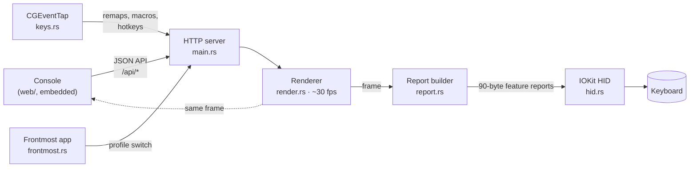

<div align="center">

<picture>
  <source media="(prefers-color-scheme: light)" srcset="assets/banner-light.png">
  
</picture>

<p>
  <a href="https://github.com/rak1337/Rig/actions/workflows/ci.yml"></a>
  
  
  <a href="LICENSE"></a>
</p>

**Lighting, remapping and macros for a Razer keyboard on macOS.**<br>
No Synapse. No kernel extension. No account.

[Quick start](#quick-start) · [Features](#features) · [Permissions](#permissions) · [How it works](#how-it-works) · [Development](#development)

</div>

---

Rig talks to the keyboard directly over USB and serves its own console in your
browser. It is one ~1.8 MB binary with three crate dependencies, nothing to
install alongside it and nothing to sign into.

It exists because Razer never shipped working macOS support for this hardware.
The Synapse build offered for it on macOS is a Synapse 2-era client whose bundle
contains no device database at all: no entry for `1532:0209`, no "BlackWidow"
string anywhere. The protocol, however, has been documented for years by
OpenRazer, and it is portable.

<!-- TODO(human): add a screenshot or short GIF of the console here, e.g.
      -->

## Quick start

You need macOS 12+, a Rust toolchain ([rustup](https://rustup.rs)) and a
supported keyboard plugged in.

```sh
git clone https://github.com/rak1337/Rig.git
cd Rig
cargo run --release
```

Your browser opens `http://127.0.0.1:7311`. The first time, macOS asks for
**Input Monitoring**; grant it and the board lights up from the console. To
check the connection without the UI:

```sh
./target/release/rig --probe
```

That prints the firmware version, device mode, brightness and indicator LEDs
read straight from the board.

> [!TIP]
> Rig doesn't have to stay running for lighting. The board keeps the last look
> it was sent, so you can set a still colour or a painted layout, quit, and it
> stays. Keep Rig running only for animated effects, remaps, macros, hotkeys,
> per-app profiles and idle blanking.

> [!TIP]
> If you do keep it running, build the app bundle (see [Install](#install)).
> macOS ties permissions to an app's identity, and a bundle keeps that identity
> across rebuilds where a bare binary may not.

## Features

| | |
| --- | --- |
| **Lighting** | 13 effects, per-key painting on the real 6 × 22 matrix, brightness, gamma and per-channel calibration |
| **Effects** | Static, Wave, Spectrum, Breathing, Reactive, Fire, Starlight, Ripple, Gradient, Marquee, Comet, Typing, Off |
| **Keys** | System-wide remapping, macros with recorded timings, macro trigger keys, a Hypershift layer while a key is held |
| **Profiles** | Saved looks and remaps, switched automatically by the frontmost app; presets, import and export |
| **Device** | Gaming mode, macro indicator, driver-mode handoff, idle blanking |
| **Shortcuts** | <kbd>⌃⌥L</kbd> lights on/off · <kbd>⌃⌥→</kbd> next effect · <kbd>⌃⌥↑</kbd> / <kbd>⌃⌥↓</kbd> brightness |

Every effect goes through one renderer, and the console preview is fed the
frame that was actually sent to the keyboard, so the two cannot drift.

### Supported hardware

| Board | USB ID | Status |
| --- | --- | --- |
| BlackWidow Tournament Edition Chroma | `1532:0209` | Tested (firmware 1.03). Per-key painting, full layout. Default. |
| BlackWidow Chroma | `1532:0203` | Known to Rig, untested. Generic layout, no per-key painting. |
| BlackWidow Chroma V2 | `1532:0221` | Known to Rig, untested. Generic layout, no per-key painting. |

Other Razer boards can be tried with `--pid <hex>`. They render with a generic
layout and may speak a different effect dialect. Reports from other hardware
are very welcome.

## Install

### From source

```sh
cargo build --release          # → target/release/rig
./scripts/bundle.sh            # → dist/Rig.app (icon, stable bundle id, ad-hoc signed)
open dist/Rig.app
```

Requires Rust 1.77 or newer (CI builds with current stable). `bundle.sh` needs
only the Xcode command-line tools for `codesign`; if signing fails, the app
still runs unsigned.

### Prebuilt

Pushing a `v*` tag builds a release with
`rig-<tag>-macos-arm64.tar.gz` (the binary), `Rig-<tag>.app.zip` and
`SHA256SUMS`. Find them on the
[releases page](https://github.com/rak1337/Rig/releases).

> [!NOTE]
> Prebuilt binaries are Apple Silicon only. On an Intel Mac, build from source.
> The app is ad-hoc signed, not notarized, so the first launch of a downloaded
> copy needs right-click → **Open** (or `xattr -dr com.apple.quarantine Rig.app`).

### Start at login

```sh
./target/release/rig --install-login     # or dist/Rig.app/Contents/MacOS/rig --install-login
./target/release/rig --uninstall-login
```

This writes `~/Library/LaunchAgents/dev.rakshak.rig.plist` pointing at the
binary you ran it from. You only need it if you use animated effects or the key
features; a still look stays on the board without it.

## Permissions

Two macOS permissions, granted per app in **System Settings → Privacy &
Security**:

| Permission | Needed for |
| --- | --- |
| **Input Monitoring** | Talking to the keyboard at all: lighting, probing |
| **Accessibility** | Remapping, macros and hotkeys, which need a system-wide event tap |

Rig asks on first use and keeps retrying, so granting while it runs works.
Lighting works with Input Monitoring alone; without Accessibility the Keys tab
says exactly what is missing rather than failing silently.

## Ways to run it

| Shape | Lighting | Remaps, macros, hotkeys | Notes |
| --- | :---: | :---: | --- |
| `rig` binary | ✓ | ✓ | Console on `127.0.0.1:7311` |
| `Rig.app` | ✓ | ✓ | Same binary, with a stable identity for permissions |
| `rig --host …` | ✓ | ✓ | Reachable from other machines, token required |
| WebHID static build | ✓ | — | No service at all; Chrome, Edge or Brave |

<details>
<summary><b>Command-line options</b></summary>

| Flag | Effect |
| --- | --- |
| `--port <n>` | Listen on another port (default `7311`) |
| `--no-open` | Don't open the browser on launch |
| `--no-restore` | Don't re-apply the saved state on launch |
| `--pid <hex>` | Target another product ID, e.g. `--pid 0221` (default `0209`) |
| `--host <addr>` | Bind to an address other than loopback; enables token auth |
| `--token <t>` | Token for `--host` (or set `RIG_TOKEN`; a random one is generated otherwise) |
| `--probe` | Read firmware, mode, brightness and indicator LEDs, then exit |
| `--test` | Hardware smoke test: set static white, read firmware, exit |
| `--install-login` / `--uninstall-login` | Add or remove the login item |
| `-h`, `--help` | Usage |

State, presets and profiles live in `~/Library/Application Support/Rig/`.

</details>

<details>
<summary><b>Running it from another machine</b></summary>

Rig binds to loopback by default. `--host` changes that and turns on token
auth, because the service drives real hardware:

```sh
RIG_TOKEN=$(openssl rand -hex 16) ./target/release/rig --host 0.0.0.0
```

Rig prints a sign-in URL of the form `http://<host>:7311/?t=<token>`. If you
don't supply a token, it generates one and prints that instead.

> [!CAUTION]
> The token grants full control: lighting, remaps, macros and synthesized
> keystrokes. Keep it on a trusted network, put real authentication in front of
> it (Cloudflare Access, a VPN), and never port-forward it to the internet.

For serving it through a Cloudflare Tunnel alongside other projects on one
domain, see [deploy/README.md](deploy/README.md).

</details>

<details>
<summary><b>The browser-only WebHID build</b></summary>

Lighting also works with no native service, straight from a Chromium browser
over WebHID:

```sh
./deploy/build-webhid.sh
python3 -m http.server 8080 --directory dist-webhid
open http://localhost:8080
```

WebHID only runs in a secure context, so serve it from `localhost` or HTTPS,
not `file://`. The output is plain static files (plus a `wrangler.jsonc` for
Cloudflare Workers) and can be hosted anywhere.

What it can't do, by design: remapping and macros need a native event tap, and
animated effects stop when the tab is hidden. A still colour persists after the
tab closes.

</details>

## How it works



Browsers can't send USB feature reports, so the native side is a local service
and the interface is a page it serves. Everything in `web/` is compiled into
the binary with `include_str!`, which is why it ships as one file.

| Path | What lives there |
| --- | --- |
| `src/main.rs` | HTTP server, JSON API, profiles, persisted state, CLI |
| `src/hid.rs` | IOKit HID transport, feature reports, permission check |
| `src/report.rs` | Razer report layout: header, checksum, frames, LED state |
| `src/render.rs` | Host-rendered effects over 132 cells |
| `src/keys.rs` | CGEventTap: remapping, macros, hotkeys, held-key layers |
| `src/devices.rs` | Known boards and the layout each is drawn with |
| `src/frontmost.rs` | Frontmost app via NSWorkspace, for per-app profiles |
| `src/input.rs` | System idle time, for backlight blanking |
| `web/` | The console (HTML, CSS, JS, fonts) |
| `webhid/` | The server-less WebHID build |
| `assets/` | Logo, app icons and banners, all generated by `make_brand.py` |
| `scripts/bundle.sh` | Builds `dist/Rig.app` |
| `deploy/` | WebHID build script, tunnel example, reusable workflows |

<details>
<summary><b>Protocol details and the key map</b></summary>

A 90-byte vendor feature report, addressed to report ID 0:

```
byte 0      status (0x00 new command, 0x02 successful)
byte 1      transaction id (0xFF for this generation)
bytes 2-3   remaining packets, big endian
byte 4      protocol type
byte 5      data size
byte 6      command class
byte 7      command id
bytes 8-87  arguments
byte 88     CRC: XOR of bytes 2..87
byte 89     reserved
```

Effects are class `0x03`, command `0x0A`. Custom frames go row by row with class
`0x03`, command `0x0B`. Driver mode is class `0x00`, command `0x04`, argument
`0x03`. Chroma boards ignore effect writes until software takes LED ownership,
so every apply begins with it.

The 6 × 22 matrix positions come from OpenRGB's `BlackWidow Chroma TE` layout,
cross-checked key-for-key against Razer's own Chroma SDK enum, where each
`RZKEY` value is literally `0xRRCC`. Both agree on all 87 keys. Column 0 is
unused on the TKL, and the spacebar is a single LED at `(5, 7)`.

</details>

## Development

```sh
cargo test --locked      # renderer, report format, key map: no hardware needed
cargo run -- --no-open   # run the service without opening a browser tab
./target/release/rig --test   # with the keyboard attached: static white + firmware read
```

CI runs `cargo test --locked` and a release build on macOS for every push to
`main` and every pull request. A `v*` tag runs the same steps, bundles the app
and publishes the release.

The console is plain HTML, CSS and JS in `web/` with no build step. Because it
is embedded at compile time, rebuild after editing it.

**Sending a change:** keep PRs focused, run `cargo test` first, and add a test
when you touch `render.rs`, `report.rs` or the key map in `keys.rs`. If you've
got a board other than the TE Chroma, a `--probe` dump in an issue is one of
the most useful things you can contribute.

## Troubleshooting

<details>
<summary><b>"macOS Input Monitoring permission is required"</b></summary>

Enable it for the app that launched Rig in **System Settings → Privacy &
Security → Input Monitoring**. When you run the bare binary from a terminal,
the grant may attach to the terminal app, and rebuilding can make macOS treat
it as a new program. Use `dist/Rig.app` to avoid both.

</details>

<details>
<summary><b>Remaps, macros or hotkeys do nothing</b></summary>

They need **Accessibility** as well as Input Monitoring. The Keys tab shows
which one is missing. Rig retries, so there's no need to restart after granting.

</details>

<details>
<summary><b>"cannot listen on 127.0.0.1:7311"</b></summary>

Another copy of Rig (perhaps the login item) is already running, or something
else has the port. Quit the other copy or pass `--port`.

</details>

<details>
<summary><b>An effect stopped moving after I quit Rig</b></summary>

Animated effects are drawn by Rig at ~30 fps and sent frame by frame. When Rig
quits, the board keeps showing the last frame it received. Still looks are
unaffected; for animation, keep Rig running (`--install-login` starts it at
login).

</details>

## Limits

- Only `1532:0209` is tested. Other boards need their own layout and possibly a
  different effect dialect.
- Firmware macros and on-board remaps are programmed from Windows Synapse and
  are not reimplemented here; Rig's remaps and macros run on the Mac.
- Animated effects are rendered on the Mac and need Rig running; without it the
  board holds the last frame.

## License

MIT, see [LICENSE](LICENSE). Protocol knowledge comes from
[OpenRazer](https://github.com/openrazer/openrazer) and
[OpenRGB](https://github.com/CalcProgrammer1/OpenRGB), both GPL-2.0. Rig is an
independent implementation of the wire format, not a derivative of their code.
