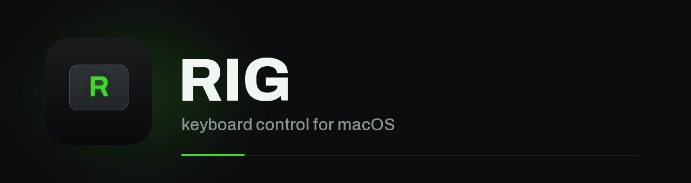

<p align="center">
  
</p>

<p align="center">
  <a href="https://github.com/rak1337/Rig/actions/workflows/ci.yml"></a>
  
  
  <a href="LICENSE"></a>
</p>

<p align="center"><em>Lighting, remapping and macros for a Razer keyboard on macOS.<br>
No Synapse. No kernel extension. No account.</em></p>

Rig talks to the keyboard directly over USB. It runs as one small local service
and serves its own console in the browser — a single binary, no dependencies,
nothing to sign into.

It exists because Razer never shipped working macOS support for this hardware.
The Synapse build available for it on macOS is a Synapse 2-era client whose
bundle contains no device database at all: no entry for `1532:0209`, no
"BlackWidow" string anywhere. The protocol, however, has been documented for
years by OpenRazer, and it is portable.

## What it does

| | |
| --- | --- |
| **Lighting** | 13 effects, per-key painting, brightness, gamma and per-channel calibration |
| **Effects** | Static, Wave, Spectrum, Breathing, Reactive, Fire, Starlight, Ripple, Gradient, Marquee, Comet, Typing |
| **Keys** | System-wide remapping, macros with recorded timings, macro trigger keys, Hypershift layer |
| **Profiles** | Saved looks and remaps, switchable per frontmost application |
| **Device** | Gaming mode, macro indicator, driver-mode handoff, idle blanking |
| **Shortcuts** | ⌃⌥L lights, ⌃⌥→ next effect, ⌃⌥↑/↓ brightness |

The renderer and the keyboard are driven from the same frame buffer, so what you
see in the console is the frame that was actually sent.

## Install

Requires macOS 12+ and a Rust toolchain.

```sh
git clone git@github.com:rak1337/Rig.git
cd Rig
cargo build --release
./target/release/rig
```

It opens `http://127.0.0.1:7311` in your browser. To build a proper app bundle
with an icon and a stable identity for permissions:

```sh
./scripts/bundle.sh
open dist/Rig.app
```

Releases are published as a macOS binary on the
[releases page](https://github.com/rak1337/Rig/releases).

## Permissions

Two macOS permissions, granted per app:

- **Input Monitoring** — lighting and reading the keyboard.
- **Accessibility** — remapping, macros and hotkeys, which need a system-wide
  event tap.

Rig asks for them on first use and retries, so granting while it runs works.
Without Accessibility the Keys tab says exactly which one is missing rather
than failing silently.

## Running it from elsewhere

Rig binds to loopback by default. `--host` changes that and requires a token,
because the service drives real hardware:

```sh
RIG_TOKEN=$(openssl rand -hex 16) ./target/release/rig --host 0.0.0.0
```

The token grants full control — lighting, remaps, macros, keystrokes. Keep it on
a trusted network, put real authentication in front of it (Cloudflare Access, a
VPN), and never port-forward it to the internet. If you host several projects
under one domain, see [deploy/README.md](deploy/README.md).

## A browser-only build

Lighting also works with no service at all, over WebHID (Chrome, Edge or Brave):

```sh
./deploy/build-webhid.sh
python3 -m http.server 8080 --directory dist-webhid
open http://localhost:8080
```

That build is static files and can be deployed anywhere — but it does lighting
only. Remapping and macros need a native event tap, and animated effects stop
when the tab is hidden.

## How it works

```
src/hid.rs      IOKit HID transport, feature reports, permission check
src/report.rs   Razer report layout: header, checksum, frames, LED state
src/render.rs   Host-rendered effects, 132 cells at ~30 fps
src/keys.rs     CGEventTap: remapping, macros, hotkeys, held-key layers
src/main.rs     HTTP server, JSON API, profiles, persisted state
web/            the console, embedded into the binary
```

Browsers cannot send USB feature reports, so the native side is a service and
the interface is a page it serves. Everything in `web/` is compiled into the
binary, which is why it ships as one file.

<details>
<summary>Protocol details and the key map</summary>

A 90-byte vendor feature report, addressed to report ID 0:

```
byte 0      status (0x00 new command, 0x02 successful)
byte 1      transaction id (0xFF for this generation)
bytes 2-3   remaining packets, big endian
byte 4      protocol type
byte 5      data size
byte 6      command class
byte 7      command id
bytes 8-87  arguments
byte 88     CRC — XOR of bytes 2..87
byte 89     reserved
```

Effects are class `0x03`, command `0x0A`. Custom frames go row by row with class
`0x03`, command `0x0B`. Driver mode is class `0x00`, command `0x04`, argument
`0x03` — Chroma boards ignore effect writes until software takes LED ownership,
so every apply begins with it.

The 6 × 22 matrix positions come from OpenRGB's `BlackWidow Chroma TE` layout,
cross-checked key-for-key against Razer's own Chroma SDK enum, where each
`RZKEY` value is literally `0xRRCC`. Both agree on all 87 keys. Column 0 is
unused on the TKL, and the spacebar is a single LED at `(5, 7)`.

</details>

## Limits

- The product ID is fixed at `0x0209` unless you pass `--pid`; other boards need
  their own profile and possibly a different effect dialect.
- Firmware macros and key remapping live on the keyboard and are programmed from
  Windows Synapse. They are not reimplemented here.
- Effects are host-driven: unplugging clears them, and reopening the app
  re-applies the saved look (`--install-login` makes that automatic).

## Development

```sh
cargo test     # renderer, report format, key map — no hardware needed
```

CI runs the tests and a release build on macOS for every push.

## License

MIT — see [LICENSE](LICENSE). Protocol knowledge from
[OpenRazer](https://github.com/openrazer/openrazer) and
[OpenRGB](https://github.com/CalcProgrammer1/OpenRGB), both GPL-2.0. This is an
independent implementation of the wire format, not a derivative of their code.
